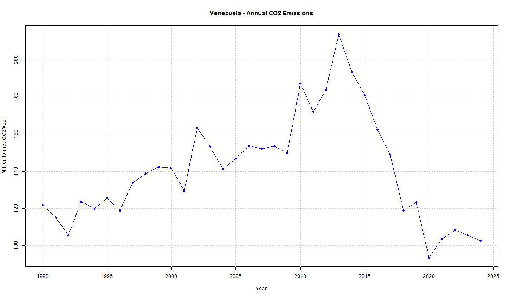
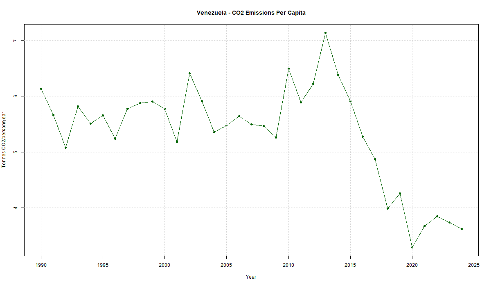
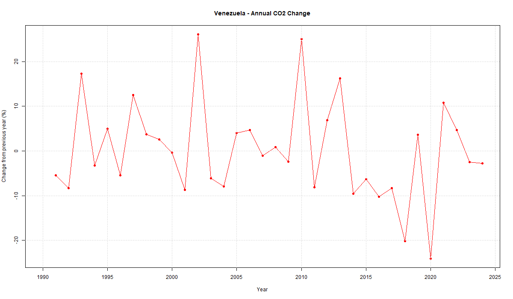

# CO2 Emissions Analysis: Venezuela

**Student:** KISHIN R. BUQUIRAN  
**Country / ISO-3:** Venezuela / VEN  
**Study Period:** 1990–2024  
**Declared to Instructor On:** 11-14-2026

## Research Question

How have annual CO2 emissions and per-capita emissions changed in Venezuela from 1990 to 2024?

## Data Source and Definitions

The data were obtained from the Our World in Data (OWID) CO2 and Greenhouse Gas Emissions dataset.

Dataset: https://github.com/owid/co2-data

Downloaded on: November 14, 2026

The selected variables are:
- country: Country name
- iso_code: Three-letter country code
- year: Observation year
- co2: Annual CO2 emissions in million tonnes
- co2_per_capita: Tonnes of CO2 per person per year

The dataset includes emissions from fossil fuels and industrial processes, excluding land-use change.

## How to Reproduce the Analysis

1. Install R, RStudio, and Git.
2. Open this repository as an RStudio Project.
3. Connect to the internet if the original OWID CSV has not yet been downloaded.
4. In the RStudio Console, run:

    source("scripts/analyze_co2.R")

5. Check the data, figures, and results folders for the generated files.

## Results

The analysis of Venezuela's CO2 emissions produced the following results:

- First valid year: 1990
- Last valid year: 2024
- CO2 emissions in 1990: 121.7065 million tonnes
- CO2 emissions in 2024: 102.7056 million tonnes
- Overall percentage change: -15.61%
- Peak emissions year: 2013
- Peak annual emissions: 213.7276 million tonnes
- Latest per-capita emissions: 3.6157 tonnes per person

### Figure 1. Annual CO2 Emissions

### Figure 2. CO2 Emissions Per Capita

### Figure 3. Annual Percentage Change

## Interpretation

This analysis examines Venezuela's fossil-fuel and industrial CO2 emissions from 1990 to 2024 using Our World in Data. The first valid annual value is 121.7065 million tonnes in 1990, compared with 102.7056 million tonnes in 2024. That represents a 15.61% decrease across the study period. However, this endpoint comparison conceals substantial changes within the series: annual emissions reached their highest recorded value of 213.7276 million tonnes in 2013, then ended markedly lower by 2024.

A notable long-term pattern is the decrease from the 2013 peak to 2024, although individual years may fluctuate. Total emissions indicate the amount released nationally in a year, while per-capita emissions divide that total by population. Venezuela's per-capita estimate was approximately 6.1384 tonnes per person in 1990 and 3.6157 tonnes in 2024. These indicators answer different questions: national emissions describe overall contribution, whereas per-capita values help interpret average emissions relative to population size.

An energy-sector context may help explain part of the observed decline. The U.S. Energy Information Administration (2024) reports that Venezuela experienced falling energy production amid economic problems, insufficient investment, infrastructure deterioration, and sanctions. These developments could affect fossil-fuel use and emissions, but the graph alone cannot establish causation. National CO2 emissions matter because accumulated greenhouse gases influence climate, which affects ecosystems and species. However, territorial CO2 data exclude emissions embodied in imports, land-use change, and other greenhouse gases, so they do not capture Venezuela's entire climate impact.

## Limitations

This analysis uses territorial CO2 emissions data, which do not include emissions embodied in imported goods. Land-use change emissions and other greenhouse gases are excluded.

The analysis covers 1990–2024 and cannot establish the exact causes of changes in emissions. Comparisons of national totals also need to consider differences in population and economic activity.

## References

1. Our World in Data. CO2 and Greenhouse Gas Emissions dataset. https://github.com/owid/co2-data

2. U.S. Energy Information Administration. (2024). Venezuela Country Analysis Brief. https://www.eia.gov/international/analysis/country/VEN
